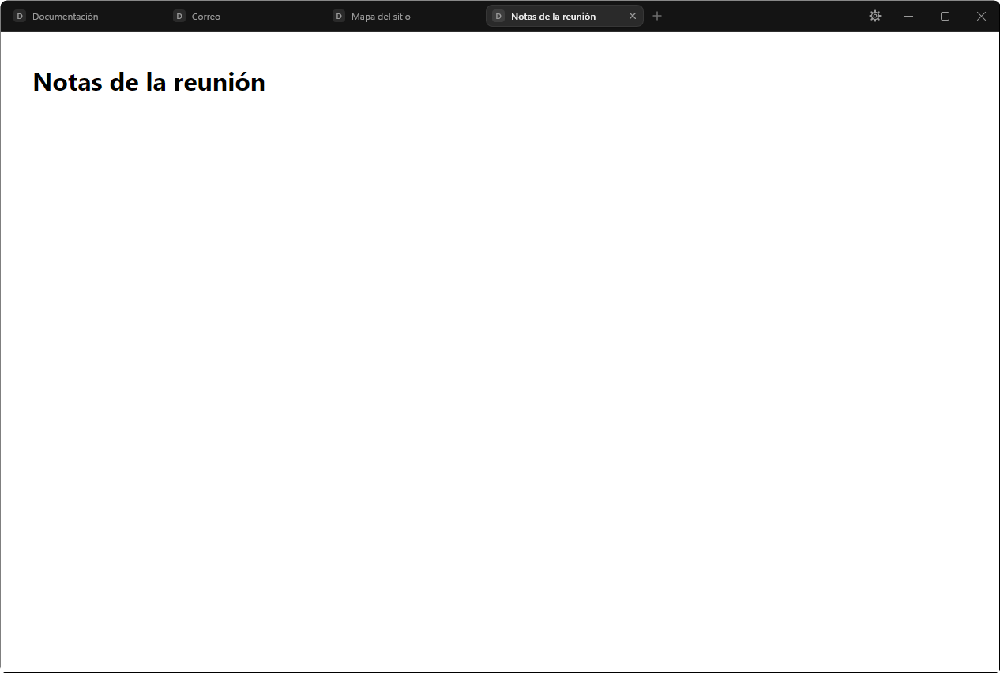
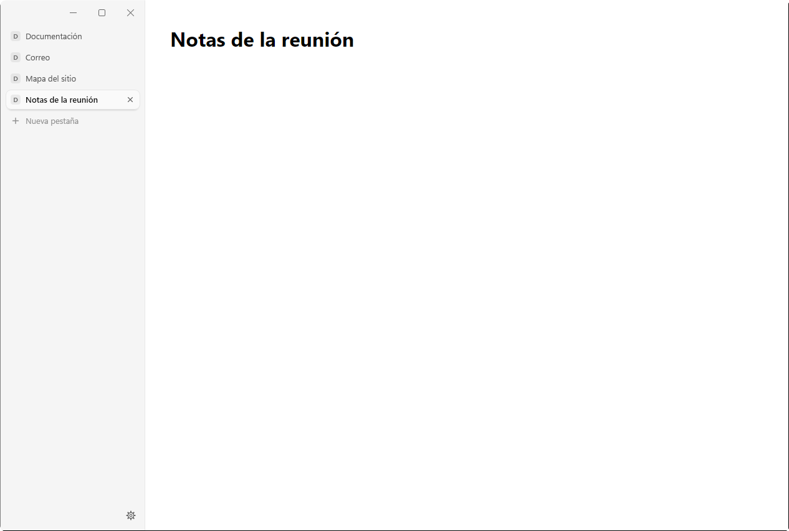
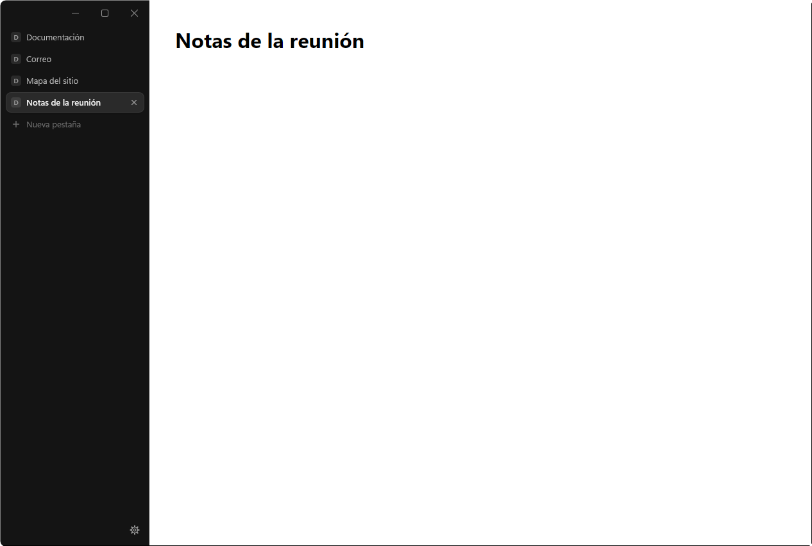
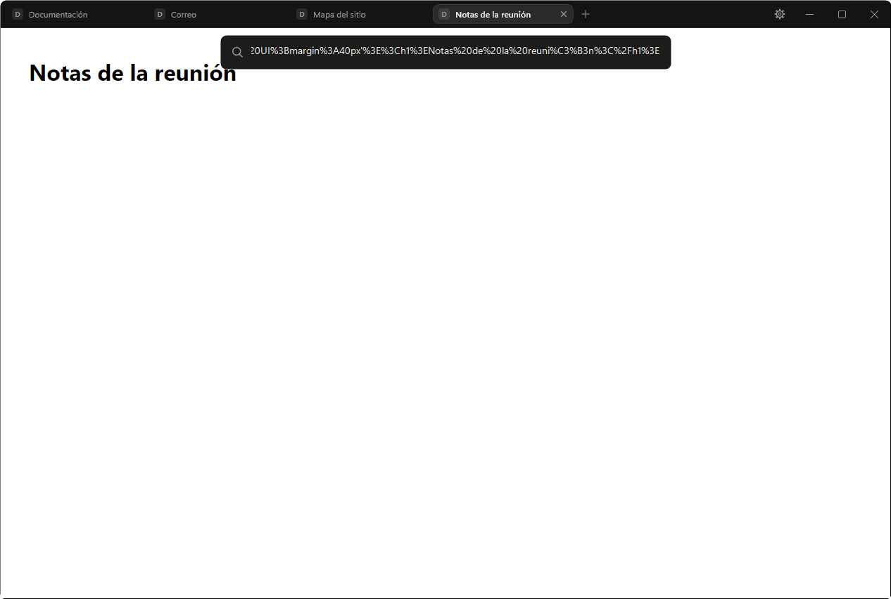
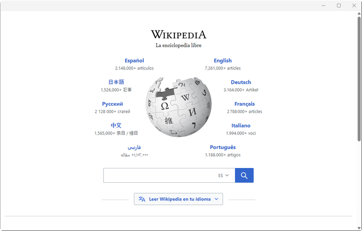
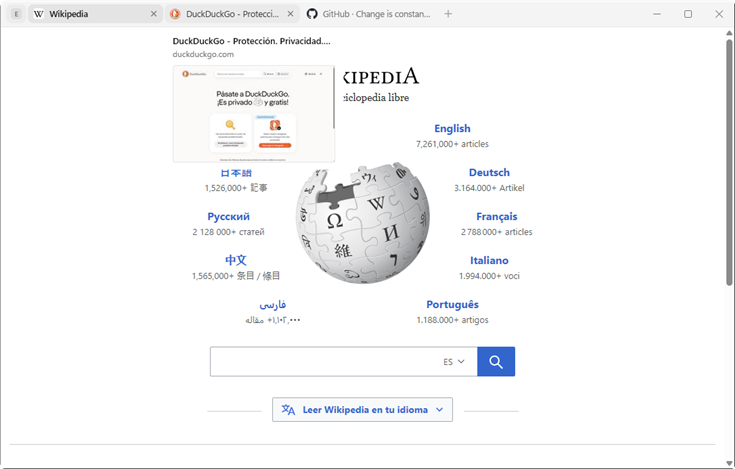
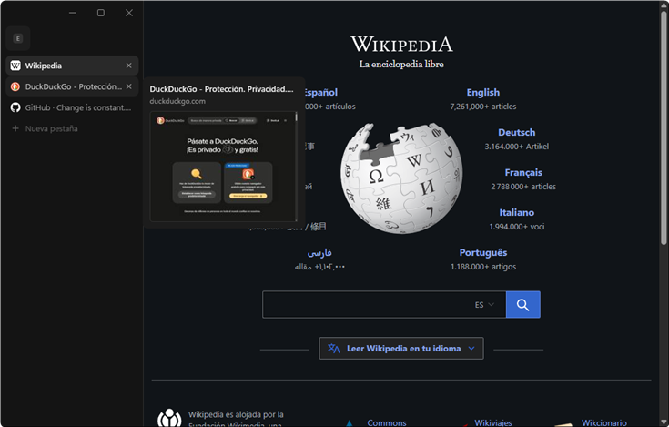
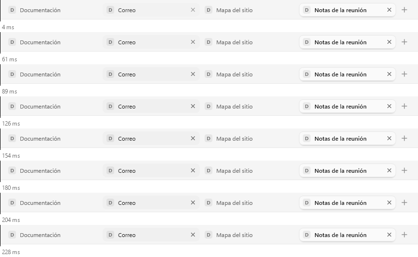
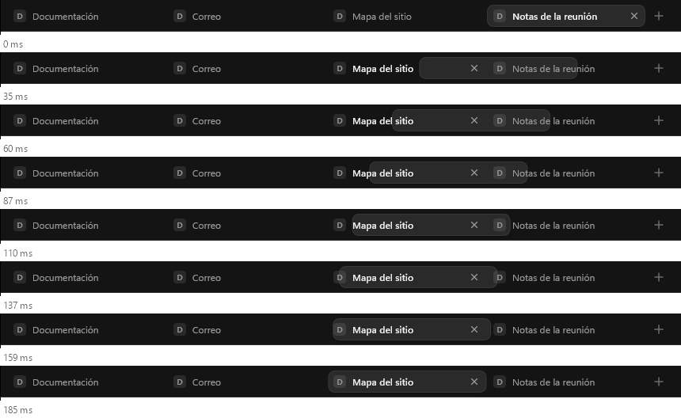

# Liviano

Un navegador para Windows pequeño, rápido y silencioso: una fila de pestañas,
un campo y la página. Sin barra de herramientas, sin página de inicio, sin
cuentas y sin telemetría. Todo pasa por un único campo que sirve para
direcciones y búsquedas.

Está escrito en Rust con interfaz Win32 nativa y usa el motor WebView2 que ya
trae Windows. La prioridad número uno es gastar poca memoria: el programa
propio ocupa unos pocos MB, las pestañas de fondo se duermen y, pasado un
rato, se descartan conservando sólo su dirección y su título.

Las ideas vienen del navegador [Search](https://github.com/driceroland/Search)
de driceroland (licencia MIT), que sirvió de referencia funcional. Liviano no
contiene su código, su nombre ni su ícono.

## Cómo se ve

La interfaz se dibuja con Direct2D y DirectWrite sobre ventanas Win32, sin
interfaz web y sin Mica (que tiñe con el fondo de pantalla). Colores, tipo,
esquinas, sombras y movimientos son los de celagem-svelte: grises neutros,
un índigo para lo activo y nada más pesado que medium. La tabla con cada
token y de dónde sale está en [docs/diseno.md](docs/diseno.md).

Todo se mueve con las curvas y duraciones de celagem:

- el hover de pestañas y botones (150 ms);
- la tarjeta de la pestaña activa, que se desliza hasta la elegida;
- las vecinas, que hacen lugar al abrir, cerrar o reordenar;
- la columna, que vuelve desde el borde;
- la línea de foco de la vista dividida;
- el campo único, la tarjeta, Ajustes y la barra de contraseñas, que
  aparecen y se van con un fundido real;
- los toasts, con su resorte;
- las casillas de Ajustes.

Una animación interrumpida sigue desde donde está. Nada bloquea la
entrada. En reposo no hay timer: 0 % de CPU. Si Windows tiene las
animaciones apagadas, todo llega de una.

El engranaje abre Ajustes y está siempre a la vista:

- con las pestañas arriba, a la izquierda de los botones de la ventana;
- con las pestañas al costado, al pie de la columna;
- con las pestañas ocultas, en la fila de la ventana.

Al dejar el puntero encima muestra el tooltip «Ajustes (Ctrl+,)».

No hay barra de título: como en Chrome y Edge, las pestañas ocupan su lugar y
los botones de minimizar, maximizar y cerrar se dibujan al final de la fila
(con las pestañas al costado, arriba de la columna, como los semáforos de
Search). El espacio libre de la fila mueve la ventana, con doble clic la
maximiza y con clic derecho abre el menú de la ventana; pasar el mouse por
maximizar muestra los diseños de ajuste de Windows 11. La sombra, los bordes
para cambiar el tamaño y las esquinas siguen siendo los de Windows.

Cada pestaña lleva el ícono de su sitio (sin ícono, o privada, su inicial).
Con el puntero quieto sobre una pestaña aparece, como en Chrome, una tarjeta
con el título entero, el sitio, si está dormida, suspendida o siempre
despierta, y una vista chica de cómo estaba la página la última vez que se la
vio (sólo en memoria, 3 MB entre todas); una pestaña dormida conserva la suya.
Pasar a otra pestaña la mueve sin esperar, y un clic, arrastrar o abrir el
campo la cierra. La vista previa se apaga en Ajustes → Pestañas (la tarjeta
queda).

| | |
|---|---|
|  |  |
|  |  |
|  |  |
|  |  |
|  |  |
|  |  |
|  |  |

Cuadros intermedios, con el tiempo de cada uno, grabados con
`tools/frames.ps1`:

| | |
|---|---|
|  |  |
|  |  |

Las capturas salen de `tools/capture.ps1` (PrintWindow, sin traer la ventana
al frente); la sombra y el borde que dibuja Windows no aparecen en ellas.

Recorrido completo, con una foto por función y un video:
[docs/muestra](docs/muestra/README.md).


## Qué hace

Estado de cada función de la especificación (sección 3) en esta versión.
"Verificado" quiere decir probado con el programa compilado, manejado por el
canal de control por script; lo que no se puede probar así está marcado.

| | Función | Estado |
|---|---|---|
| RF-01 | Campo único para direcciones y búsquedas | Verificado. Nada sale hasta Enter. |
| RF-02 | Autocompletado desde el historial local | Verificado (sugerencias y completado en línea). |
| RF-03 | Pestañas arriba o al costado, barra lateral plegable | Verificado. Se elige en Ajustes → Pestañas → Ubicación, en el menú de clic derecho de la fila (o de la ventana) y con Ctrl+Shift+S. |
| RF-04 | Pestañas fijadas | Verificado; persisten entre sesiones. |
| RF-05 | Restauración diferida | Verificado: al abrir sólo se crea la vista de la pestaña activa (y la de su par, si está dividida). |
| RF-06 | Cambiar de pestaña por nombre | Verificado (búsqueda difusa por título y dirección). |
| RF-07 | Dormir y descartar pestañas de fondo | Verificado: se suspenden pasado el tiempo de Ajustes y se descartan después, o enseguida con poca memoria. |
| RF-08 | Mantener un sitio despierto | Verificado. |
| RF-09 | Vista dividida | Verificado (pares, persistencia, privadas). El arrastre de pestañas y del divisor se revisa a mano. |
| RF-10 | Modo lectura | Verificado (Readability). |
| RF-11 | Ocultar elementos por sitio | Verificado (selección por clic, se aplica antes de pintar). La lista de ocultos (Ctrl+Shift+U) es un menú: se revisa a mano. |
| RF-12 | Video flotante | Hecho con el Picture-in-Picture del motor. Sin verificar en esta pasada (hace falta una página con video). |
| RF-13 | Bloqueo de anuncios y trackers | Verificado, con excepción por sitio (menú de la pestaña). Usa EasyList y EasyPrivacy, con una lista mínima incluida mientras se descargan. Ver "Bloqueo y privacidad". |
| — | Ventanas emergentes | Verificado con páginas locales: se bloquean las que nadie pidió y las de anuncios; se permiten por sitio desde el menú de la pestaña. |
| — | Rastreadores y carteles de cookies | Verificado: prevención de rastreo estricta del motor y carteles ocultos antes del primer cuadro (EasyList Cookie List). |
| RF-14 | Contraseñas en el Administrador de credenciales | Verificado: ofrece guardar tras un login y nunca rellena solo. Ctrl+Alt+L abre el panel. |
| RF-15 | Importar contraseñas de otros navegadores | Hecho (Chrome, Edge, Brave, Vivaldi, Opera, Arc y CSV, todo en el equipo). Sin verificar en esta pasada: las pruebas no leen perfiles reales. |
| RF-16 | Llaves de acceso | El motor deriva WebAuthn al diálogo de Windows Hello. Sin verificar en esta pasada. |
| RF-17 | Tema claro, oscuro o del sistema | Verificado claro y oscuro; "del sistema" sigue el cambio de Windows. |
| RF-18 | Marcadores, historial y descargas | Verificado. |
| RF-19 | Pestañas privadas | Verificado: perfil InPrivate propio; nada va al historial, a la sesión, a Ctrl+Shift+T ni a settings.json. |
| RF-20 | Extensiones de Chrome | Verificado: carga, botón (sólo si hay extensiones) y fijadas. Limitaciones en [docs/extensiones.md](docs/extensiones.md). |
| RF-21 | Buscar en la página | Verificado. |
| RF-22 | Actualización diaria firmada | Hecho, con pruebas unitarias. **Apagado** hasta definir el dueño del repositorio de versiones (ver al final). |
| RF-23 | Control por script | Verificado (ver "Control por script"). |
| RF-24 | Ajustes | Verificado: general, pestañas, contraseñas, extensiones, atajos, actualizaciones, privacidad y pruebas; todo se guarda al momento. |

La memoria medida contra Edge está en [docs/medicion.md](docs/medicion.md).

## Requisitos

- Windows 10 u 11 (x64).
- El runtime de WebView2 (Evergreen). Viene con Windows 11 y con casi todos los
  Windows 10 actualizados. Si falta, el instalador avisa y ofrece la
  [descarga oficial](https://go.microsoft.com/fwlink/p/?LinkId=2124703).

## Instalar

- **Instalador:** `Liviano-<versión>-setup.exe`. Se instala para el usuario
  actual, sin permisos de administrador, en `%LOCALAPPDATA%\Programs\Liviano`,
  con acceso directo en el menú Inicio y entrada en Configuración → Aplicaciones
  (desde ahí se desinstala).
- **Portable:** `Liviano-<versión>-portable.zip`. Se descomprime donde sea y se
  abre `liviano.exe`; no toca el registro.

El mismo `liviano.exe` entiende `--install` y `--uninstall` (más `--quiet` para
hacerlo sin preguntas, como lo usa winget).

## Atajos

Todos se pueden cambiar en Ajustes (Ctrl+,).

| Acción | Atajo |
|---|---|
| Barra de direcciones | Ctrl+L |
| Cambiar de pestaña por nombre | Ctrl+K |
| Nueva / cerrar / reabrir pestaña | Ctrl+T / Ctrl+W / Ctrl+Shift+T |
| Nueva pestaña privada | Ctrl+Shift+N |
| Atrás / adelante | Alt+Izquierda / Alt+Derecha |
| Pestaña anterior / siguiente | Ctrl+Shift+Tab / Ctrl+Tab (y Ctrl+RePág / Ctrl+AvPág) |
| Ir a la pestaña 1 a 8 / a la última | Ctrl+1 … Ctrl+8 / Ctrl+9 |
| Pestañas arriba / al costado | Ctrl+Shift+S |
| Ocultar / mostrar las pestañas | Ctrl+S |
| Buscar en la página | Ctrl+F |
| Duplicar pestaña | Ctrl+D |
| Copiar dirección / pegar e ir | Ctrl+Shift+C / Ctrl+Shift+V |
| Recargar / recargar sin caché | F5 o Ctrl+R / Ctrl+F5 |
| Marcar página | Ctrl+Shift+B |
| Marcadores / historial / descargas | Ctrl+Shift+O / Ctrl+Y / Ctrl+Shift+J |
| Modo lectura | Ctrl+Shift+R |
| Video flotante | Ctrl+Shift+P |
| Ocultar elemento / ver ocultos | Ctrl+Shift+H / Ctrl+Shift+U |
| Vista dividida / deshacerla | Ctrl+Alt+N / Ctrl+Alt+Shift+N |
| Ir a la página dividida de la izquierda / derecha | Alt+Shift+Izquierda / Alt+Shift+Derecha |
| Contraseñas | Ctrl+Alt+L |
| Ajustes | Ctrl+, |

Las pestañas van arriba o al costado según Ajustes → Pestañas → Ubicación
(ahí también se ocultan), y desde el menú de clic derecho de una pestaña o
del espacio libre de la fila ("Pestañas al costado" / "Pestañas arriba").
Si otro programa tiene tomado un atajo para todo el sistema (PowerToys suele
quedarse con Ctrl+Shift+S), Ajustes lo marca "otro programa" en la lista de
atajos: ese atajo no le llega a Liviano y conviene asignarle otro.

Fijar una pestaña, mantener un sitio despierto, el bloqueo de anuncios en un
sitio y "Permitir ventanas emergentes en este sitio" están en el menú de la
pestaña (clic derecho) y no tienen atajo de fábrica; se les puede asignar uno
en Ajustes.

## Bloqueo y privacidad

Todo sale del mismo lugar: el menú de la pestaña para un sitio, y Ajustes →
Privacidad para todos.

- **Anuncios y rastreadores (red).** EasyList y EasyPrivacy, bajadas una vez
  por día. "Bloqueo de anuncios en este sitio" lo apaga para ese sitio, junto
  con lo que sigue salvo la prevención de rastreo del motor.
- **Ventanas emergentes.** Una ventana que la página abre sin que medie un
  clic o una tecla se bloquea siempre; una abierta con un clic se bloquea sólo
  si su dirección es un anuncio según las listas (reglas `$popup` o un
  servidor de anuncios entero: los popunders que se cuelgan del primer clic).
  Los logins con ventana (Google, Microsoft, Facebook, Apple, GitHub, PayPal)
  se abren: una prueba con las listas reales lo comprueba. Al bloquear, la
  página muestra "Ventana emergente bloqueada" y "Permitir ventanas emergentes
  en este sitio" (menú de la pestaña) las deja pasar; desde una pestaña
  privada ese permiso dura hasta cerrar Liviano y no se guarda. Las páginas de
  extensiones no se tocan.
- **Rastreadores y cookies de terceros** (Ajustes → Privacidad, "Bloquear
  cookies de terceros y rastreadores", prendido de fábrica). La prevención de
  rastreo del motor en nivel *estricto*: medido, no deja cargar los scripts de
  Facebook, Google Analytics ni Hotjar desde un sitio ajeno (el nivel
  equilibrado, el de fábrica del motor, los dejaba pasar) y los logins de
  Google, Microsoft, GitHub y Amazon siguen cargando. Sus cookies y su
  almacenamiento quedan bloqueados con ellos; las cookies del sitio que se
  visita (las de la sesión) no se tocan. El motor no ofrece excepciones por
  sitio para este nivel, así que la excepción del bloqueo de anuncios no lo
  relaja. Las cookies de terceros que no son de rastreadores conocidos no se
  bloquean: WebView2 no tiene una opción soportada para eso (la única que
  funciona, `--test-third-party-cookie-phaseout`, es un interruptor de prueba
  de Chromium, no documentado para WebView2, y se dejó afuera).
- **Carteles de cookies.** Con el mismo interruptor: la EasyList Cookie List
  (de `secure.fanboy.co.nz`, bajada con las otras) oculta los avisos de
  consentimiento con sus reglas `##`, `dominio##` y `#@#` y corta, sitio por
  sitio, los scripts de gestores de consentimiento que la lista nombra. Cada
  documento le pide a Liviano, al crearse, las reglas de su sitio (unas 180)
  y, a medida que aparecen, las genéricas de los `#id` y `.clase` que de
  verdad tiene, como hace uBlock: hasta el primer cuadro lo pregunta sin
  esperar, así que un cartel no llega a pintarse. Son pedidos que nunca salen
  de la máquina. Con las 15.000 reglas genéricas de entrada, cada pestaña
  gastaba ~10 MB más en su proceso; así, menos de 1 MB, y la página tarda
  ~15 ms más en estar lista. Si el cartel bloqueaba el desplazamiento, se
  libera. Los muros de "aceptá o pagá" (Spiegel, Corriere, The Guardian) la
  lista no los oculta a propósito. Compilada ocupa ~1,3 MB en memoria de
  Liviano; apagada, no se compila.

## Compilar

Hace falta Rust estable con el destino `x86_64-pc-windows-msvc` y las
herramientas de compilación de Visual Studio (MSVC).

```powershell
cargo build            # desarrollo: se llama "Liviano (desarrollo)"
cargo build --release  # la versión que se publica
```

Los tests viven en un repositorio privado.

La compilación de desarrollo se distingue en el título de la ventana, en el
acceso directo y en Ajustes, y no busca actualizaciones salvo que
`settings.json` tenga una dirección explícita (`update_url`).

`build.ps1` compila, firma y empaqueta todo en `dist\`:

```powershell
.\build.ps1                       # release, sin firmar (avisa)
.\build.ps1 -Dev                  # variante de desarrollo
.\build.ps1 -CertificatePath cert.pfx -CertificatePassword ... `
            -UpdateKey C:\secretos\liviano-update.key `
            -PackageUrl https://github.com/<owner>/liviano/releases/download/v0.2.0/liviano.exe
```

Deja `liviano.exe`, `Liviano-<versión>-setup.exe`, `Liviano-<versión>-portable.zip`,
`latest.json` (si se pasó `-UpdateKey`) y `SHA256SUMS.txt`. El zip se arma
con orden y fechas fijos (las del último commit), así que no cambia entre
corridas si no cambia el programa. Sin certificado de firma de código el
script avisa y sigue: el programa funciona, pero SmartScreen advierte al abrirlo.

En `packaging/winget/` hay un manifiesto de winget de ejemplo (sin publicar).

## Control por script

Para pruebas y medición (RF-23). Está apagado: se prende en Ajustes →
Pruebas o arrancando con `LIVIANO_BENCH=1`. Escucha sólo en un *named pipe*
local, accesible únicamente para el usuario actual. Las pestañas que abre son
"de prueba": no van al historial, a la sesión ni a Ctrl+Shift+T.

```powershell
$env:LIVIANO_DATA_DIR = "$env:TEMP\liviano-prueba"   # datos aparte
$env:LIVIANO_BENCH = "1"
$env:LIVIANO_BENCH_PIPE = "prueba"   # otro canal, sin chocar con el de uso diario
.\target\release\liviano.exe

cargo run --release --example bench -- open https://example.com/
cargo run --release --example bench -- wait
cargo run --release --example bench -- text
cargo run --release --example bench -- run new_tab   # cualquier comando por su nombre
cargo run --release --example bench -- type "example.com" --submit
cargo run --release --example bench -- state         # pestañas, campo, pares, privadas
cargo run --release --example bench -- shield        # bloqueos, reglas, popups y lista de cookies
cargo run --release --example bench -- quit
```

`tools\bench.ps1` hace lo mismo desde PowerShell y `tools\measure.ps1` corre
los escenarios de memoria. `LIVIANO_CREDENTIAL_PREFIX` (por ejemplo
`LivianoTest:`) separa las contraseñas de una corrida de prueba de las reales.
Con otra aplicación al frente, Liviano no toma el teclado: una corrida por
script no interrumpe a quien escribe en otra ventana.

## Diagnóstico: cierres y cuelgues

Siempre activo y sin costo apreciable (un hilo que mira una vez por segundo
si la ventana sigue procesando mensajes). Nada sale de la máquina: son
archivos de texto en la carpeta de datos (`%APPDATA%\Liviano`, o
`LIVIANO_DATA_DIR`), de 256 KB como máximo cada uno (el anterior queda como
`*.log.old`).

| Archivo | Qué anota |
|---|---|
| `crash.log` | Un *panic* (mensaje, archivo y línea, hora, versión y qué estaba haciendo la ventana), una excepción no manejada (código y dirección dentro de `liviano.exe`) y cada proceso del motor que se cae o deja de responder: el del navegador, el de una página, la GPU… con su motivo y código de salida. |
| `hang.log` | La ventana trabada más de 2 s: desde cuándo y haciendo qué (un evento del motor, un comando, un temporizador, el pipe de pruebas, una solicitud del bloqueador…), y cuándo volvió a responder. También cualquier paso suelto que tardó más de 250 ms. |

Si Liviano se cierra solo o se queda "sin responder", esos dos archivos
dicen dónde. Cuando se cae el proceso del motor entero, Liviano lo vuelve a
arrancar y recarga las pestañas visibles (hasta tres veces en dos minutos);
si se cae la GPU o un proceso auxiliar, el motor se recupera solo y las
pestañas no se tocan.

Para que Enter no espere al motor, Liviano prepara una vista de reserva
cuando está por necesitarla: al abrir el campo de pestaña nueva, mientras se
escribe en él, con el puntero sobre una pestaña dormida o al cambiar de
pestaña habiendo alguna dormida. Con la ventana vacía, el motor arranca con
la primera tecla y no al abrirla. Si nadie usa la vista en 30 s se cierra, y
si el motor se había arrancado sólo para ella también se apaga: una ventana
quieta no guarda nada de más.

Para medir, `LIVIANO_TRACE=1` agrega `trace.log`: una marca con hora (en ms
desde el arranque) por cada paso entre Enter y la página, y cada manejador
que tardó más de 4 ms. `tools\latency.ps1` lo usa para medir la latencia del
campo en frío, en caliente y con una pestaña dormida, y con `-Usage` una
pasada de uso pesado (30 pestañas reales, historial de 20 000 entradas) que
resume los manejadores lentos y lo que haya quedado en `hang.log`.

## Actualizaciones

Una vez por día, en segundo plano, Liviano lee un manifiesto (`latest.json`).
Si anuncia una versión mayor, descarga el paquete a
`%LOCALAPPDATA%\Liviano\update` y verifica su firma Ed25519 contra la clave
pública que viene dentro del programa. Si la firma no verifica, lo descarta.
Nunca reinicia por su cuenta: la próxima vez que se abre Liviano, antes de
mostrar la ventana, reemplaza el ejecutable (el anterior queda como
`liviano.old` y se borra en el arranque siguiente) y sigue con la versión nueva.

Si el manifiesto no responde, no pasa nada y se vuelve a intentar al día
siguiente. La comprobación se apaga en Ajustes → Actualizaciones, donde también
se ve la versión instalada.

### Firmar una versión

La firma cubre la versión y los bytes del paquete, así que un paquete viejo no
se puede servir como si fuera nuevo.

1. Generar el par de claves de producción, una sola vez, fuera del repositorio:

   ```powershell
   cargo run --example keygen -- C:\secretos\liviano-update.key keys\update-public.hex
   ```

   La clave privada se guarda en un gestor de secretos y no se commitea nunca
   (`keys/*.key` está en `.gitignore`). La pública (`keys/update-public.hex`)
   sí se commitea: es la que se compila dentro del programa. La que está hoy
   en el repo es una clave de **desarrollo** y hay que reemplazarla antes de
   la primera versión pública.
2. El actualizador lee `latest.json` del último release de
   `github.com/Agustin-Delgado/liviano` (`RELEASES_OWNER` en `src/updater.rs`).
3. `.\build.ps1 -UpdateKey <clave privada> -PackageUrl <dirección de liviano.exe>`
   y subir `liviano.exe` y `latest.json` al release.

Firmar a mano: `cargo run --example sign -- <paquete> <clave privada> [--version x.y.z] [--url dirección] [--out latest.json]`.

## Datos y privacidad

Sin cuentas, sin sincronización, sin telemetría y sin reporte de fallos. Lo
único que sale a la red son las páginas que se piden, sus íconos y la
comprobación diaria de actualización (que se puede apagar). El campo no envía
nada hasta presionar Enter: el autocompletado sale del historial local.

| Dato | Dónde |
|---|---|
| Ajustes, pestañas abiertas, historial, marcadores, descargas, elementos ocultos, extensiones | `%APPDATA%\Liviano\*.json` |
| Listas de filtros (anuncios, rastreo, cookies) y extensiones de la Web Store | `%APPDATA%\Liviano\shield`, `%APPDATA%\Liviano\extensions` |
| Sitios con excepción de bloqueo o con ventanas emergentes permitidas | `settings.json` (`shield_disabled`, `popups_allowed`) |
| Contraseñas | Administrador de credenciales de Windows (genéricas `Liviano:<origen> <usuario>`) |
| Íconos de los sitios (nunca los de pestañas privadas), hasta 4 MB | `%APPDATA%\Liviano\favicons` |
| Cookies, caché y datos de sitios | `%LOCALAPPDATA%\Liviano\engine` (perfil propio, separado de Edge) |
| Actualización descargada | `%LOCALAPPDATA%\Liviano\update` |
| Programa instalado | `%LOCALAPPDATA%\Programs\Liviano` |

Los JSON se escriben de forma atómica (archivo temporal y reemplazo), así que
un corte no deja un archivo a medias. Al desinstalar se borra el programa y la
actualización descargada; los datos quedan, por si se vuelve a instalar, y se
borran a mano eliminando esas carpetas.

## Lo que falta y requiere a una persona

El código está completo; estas decisiones y secretos no pueden salir de él:

- **Primer release.** El actualizador ya apunta a los releases de
  `github.com/Agustin-Delgado/liviano`; mientras no haya ninguno, la
  comprobación diaria no encuentra nada y no hace nada.
- **Clave de firma de producción.** La pública de `keys/update-public.hex` es
  de desarrollo. Hay que generar el par de producción (ver "Firmar una
  versión"), guardar la privada en un gestor de secretos y commitear sólo la
  pública.
- **Certificado de firma de código.** Sin él, SmartScreen advierte al abrir
  el instalador y el programa. `build.ps1 -CertificatePath` lo usa cuando
  existe.
- **Correo de seguridad.** `SECURITY.md` tiene `<correo-de-seguridad>` como
  marcador.
- **winget.** El manifiesto de `packaging/winget/` es un ejemplo sin
  publicar; necesita la dirección y el hash del primer release.

Se revisan a mano: arrastrar pestañas y el divisor de la vista dividida, los
menús (pestaña, extensiones, elementos ocultos, cuentas de un login), el video
flotante, la importación de contraseñas y las llaves de acceso.

## Seguridad

Para reportar una vulnerabilidad, ver [SECURITY.md](SECURITY.md). Por favor no
abras un issue público.

## Licencia

MIT (ver [LICENSE](LICENSE)). Componentes de terceros en [NOTICE](NOTICE).
