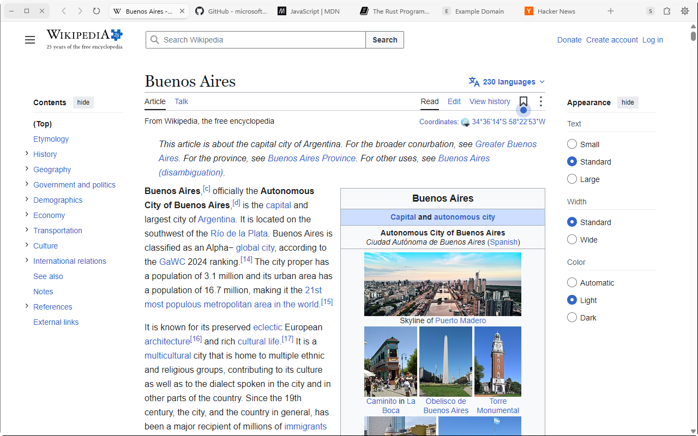

<p align="center">
  <picture>
    <source media="(prefers-color-scheme: dark)" srcset="assets/logo/nea-dark.svg">
    
  </picture>
</p>

<h1 align="center">Nea</h1>

<p align="center">Nea is a Windows browser that uses little memory. It has one tab strip, one field and the page.</p>

<p align="center">
  <a href="https://github.com/Agustin-Delgado/nea/actions/workflows/ci.yml"></a>
  <a href="https://github.com/Agustin-Delgado/nea/actions/workflows/release.yml"></a>
  <a href="https://github.com/Agustin-Delgado/nea/releases/latest"></a>
  <a href="LICENSE"></a>
  
</p>

<picture>
  <source media="(prefers-color-scheme: dark)" srcset="docs/showcase/01-tabs-top-dark.png">
  
</picture>

Nea has no toolbar, no start page, no accounts and no telemetry. You use one
field for addresses and searches. Nea is written in Rust. Its native Win32
interface is drawn with Direct2D. It uses the WebView2 engine that Windows
already includes.

## Why Nea uses little memory

The program itself uses a few MB. Background tabs go to sleep in seconds:
their scripts stop and their memory goes back to the system. They
are not closed, so a tab comes back as it was, with no load. At startup,
Nea creates only the view of the active tab.

## Comparison

| | Nea 0.1.16 | Edge | Chrome | Brave |
|---|---:|---:|---:|---:|
| **Memory** | | | | |
| One blank tab | 109 MB | 122 MB | 191 MB | 202 MB |
| 20 heavy sites, open | 416 MB | 2586 MB | 3041 MB | 2651 MB |
| 20 heavy sites, 5 min with no input | 47 MB | 2619 MB | 3152 MB | 2323 MB |
| 20 light pages, open | 192 MB | 401 MB | 466 MB | 456 MB |
| 20 light pages, 5 min with no input | 20 MB | 408 MB | 506 MB | 463 MB |
| **Size** | | | | |
| Installed size | 3 MB ¹ | 1177 MB | 525 MB | 1100 MB |
| **Features** | | | | |
| Engine | WebView2 (Chromium) | Chromium | Chromium | Chromium |
| Blocks ads by default | Yes | No ² | No | Yes |
| Extensions from the Chrome Web Store | Partly ³ | Yes | Yes | Yes |
| Accounts and sync | No | Yes | Yes | Yes |
| Telemetry on by default | No | Yes | Yes | Yes ⁴ |
| Built-in AI assistant | No | Yes (Copilot) | Yes (Gemini) | Yes (Leo) |
| Open source | Yes (MIT) | No | Partly ⁵ | Yes (MPL 2.0) |

Memory is the private working set of the full process tree, with nothing
forced. Each browser opened the same pages with a new profile. "Heavy
sites" are 10 real sites, each two times: Wikipedia, GitHub, MDN, YouTube,
Reddit, Infobae, La Nación, Amazon, Stack Overflow and NYTimes. Each figure
is the median of 3 to 7 runs on Windows 11. The 20-tab runs of Nea, Edge
and Chrome are from 2026-11-27. The Brave runs and the blank tab are from
2026-11-28: on that day, Nea had 473 and 55 MB with the heavy sites. A tab
that comes back from sleep shows again in approximately 170 ms, with no
load.

1. `nea.exe` only. Nea uses the WebView2 runtime that Windows includes
   (1152 MB, shared with other apps).
2. Edge blocks trackers, not ads.
3. Some extension APIs are not available: see
   [docs/extensions.md](docs/extensions.md).
4. Brave sends private product analytics (P3A) by default.
5. Chromium is open source. Chrome adds closed parts.

The runs, the method and the limits are in
[docs/memory.md](docs/memory.md#results). The single-page scenarios are in
[docs/benchmarks.md](docs/benchmarks.md).

## Features

- **One field** for addresses and searches, with suggestions from the local
  history. Nea sends nothing until you press Enter.
- **Tab strip on top or on the side.** You can hide it. It has pinned tabs,
  colored groups and a search for tabs by name.
- **Split view**: two pages side by side.
- **Private tabs** with their own InPrivate profile.
- **Reader mode**, **floating video** and **hide element** for each site.
- **Passwords** in Windows Credential Manager. You can import them from
  Chrome, Edge, Brave, Vivaldi, Opera, Arc or a CSV file.
- **Bookmarks, history and downloads** in panels that open from the field.
- **Default browser.** Settings → General → **Make Nea the default…** opens
  the page in Windows Settings where you select Nea. Links from other apps
  then open in a new tab.
- **Chrome extensions** from the Web Store, with
  [known limitations](docs/extensions.md).
- **Light, dark or system theme.** The animations obey the Windows setting.
- **Signed updates** with an Ed25519 signature. Nea checks every 4 hours
  and shows **Update** when a new version is ready.

The status of each feature and the screenshots are in
[docs/features.md](docs/features.md). The [showcase](docs/showcase/README.md)
has one screenshot for each feature and a video.

## Install

Requirements: Windows 10 or 11 (x64) and the
[WebView2 runtime](https://developer.microsoft.com/microsoft-edge/webview2/).
Windows 11 and almost all updated Windows 10 installations include it.

1. Download `nea.exe` from the
   [latest release](https://github.com/Agustin-Delgado/nea/releases/latest).
2. Run it.

Or install it with [winget](https://learn.microsoft.com/windows/package-manager/)
(after the package is accepted):

```powershell
winget install nea
```

Nea runs from where it is, as a portable app. It does not change the
registry. Your data goes to `%APPDATA%\Nea`.

To install Nea for the current user, download `Nea-<version>-setup.exe`
instead and run it, or run `nea.exe --install`. The installer copies Nea to
`%LOCALAPPDATA%\Programs\Nea` and adds a Start menu shortcut and an entry in
Settings → Apps. It does not need administrator rights. Use the entry in
Settings → Apps to uninstall Nea.

**SmartScreen warning.** The files are not signed with a code signing
certificate. When you run them for the first time, Windows can show "Windows
protected your PC". Select **More info**, then **Run anyway**. To make sure
that the file is the published one, compare its SHA-256 hash with
`SHA256SUMS.txt` in the release:

```powershell
Get-FileHash .\nea.exe -Algorithm SHA256
```

Nea checks for updates soon after it starts and then every 4 hours. It keeps
an update only if the Ed25519 signature of the update is correct. When an
update is ready, a small **Update** button shows next to the gear. Click it
(or select **Restart to update** in the menu of the tab strip) to restart
Nea. Nea saves your tabs, starts the new version and opens your tabs again.
If you do not click it, Nea installs the update at the next start.

### Build from the source code

You need the Visual Studio build tools (MSVC) with the Windows SDK, and
[rustup](https://rustup.rs). `rust-toolchain.toml` selects the Rust version.

```powershell
git clone https://github.com/Agustin-Delgado/nea.git
cd nea
cargo build --release
.\target\release\nea.exe
```

If you have access to the tests, clone with `--recurse-submodules`. The
tests are in a private repository. CI tests the pull requests.
[docs/building.md](docs/building.md) explains the build, the tests and the
release.

## Shortcuts

| Action | Shortcut |
|---|---|
| Field | Ctrl+L |
| Switch to tab by name | Ctrl+K |
| New tab / close tab / reopen closed tab | Ctrl+T / Ctrl+W / Ctrl+Shift+T |
| New private tab | Ctrl+Shift+N |
| Tab strip on top or on the side / hide tabs | Ctrl+Shift+S / Ctrl+S |
| Find in page | Ctrl+F |
| Reader mode | Ctrl+Shift+R |
| Split view | Ctrl+Alt+N |
| Bookmarks / history / downloads | Ctrl+Shift+O / Ctrl+Y / Ctrl+Shift+J |
| Settings | Ctrl+, |

You can change all shortcuts in Settings. The full list is in
[docs/shortcuts.md](docs/shortcuts.md).

## Privacy

Nea has no accounts, no sync, no telemetry and no crash reports. Nea sends
only these items to the network: the pages that you open, their icons, the
filter lists and the update check. You can turn off the update check.

- **Ads and trackers:** Nea blocks them at the network level with EasyList and
  EasyPrivacy.
- **Trackers and third-party cookies:** Nea uses the strict level of the
  engine's tracking prevention.
- **Cookie banners:** Nea hides them before they appear. It uses the EasyList
  Cookie List.
- **Pop-ups:** Nea blocks pop-ups that nobody asked for and ad pop-ups.
  Sign-in pop-ups continue to work.

You can allow ads and pop-ups for one site from the tab menu.
[docs/privacy.md](docs/privacy.md) gives the details and the location of each
data file.

## Code signing policy

Nea is not signed with a code signing certificate yet. The SignPath
Foundation declined the application in November 2026 until the project is
better known, and invited a new application later. When a certificate
comes, these rules apply to it.

- Committers and reviewers: [Agustin-Delgado](https://github.com/Agustin-Delgado)
- Approvers: [Agustin-Delgado](https://github.com/Agustin-Delgado)

Only the files that the [Release workflow](.github/workflows/release.yml)
builds from this repository on GitHub-hosted runners get a signature. A
person approves each signing request. Each change from outside the team gets
a review before the merge.

Privacy: this program will not transfer any information to other networked
systems unless specifically requested by the user or the person installing
or operating it. The pages that you open, the filter lists and the
update check are the only network traffic. [Privacy](#privacy) and
[docs/privacy.md](docs/privacy.md) give the details.

## Documentation

- [Features](docs/features.md): what Nea does, how it looks and what is verified.
- [Shortcuts](docs/shortcuts.md).
- [Privacy and data](docs/privacy.md).
- [Sign-in with Google](docs/sign-in.md): one sign-in for all sites, and what Nea cannot sync.
- [Build, install and publish](docs/building.md): `build.ps1`, script control,
  diagnostics and updates.
- [Memory benchmarks](docs/benchmarks.md).
- [Extensions](docs/extensions.md).
- [Design and motion](docs/design.md).
- [Showcase](docs/showcase/README.md): screenshots and video.

## Status

- **Code signing certificate.** Nea has none yet. Thus SmartScreen shows a
  warning when you open the installer or the program, and Microsoft Defender
  can quarantine it by mistake (see [Code signing policy](#code-signing-policy)).
- **winget.** The package `Nea.Browser` is in review in
  [microsoft/winget-pkgs#486029](https://github.com/microsoft/winget-pkgs/pull/486029).
  `packaging/winget/` holds the submitted manifest.

## Contributing

Read [CONTRIBUTING.md](CONTRIBUTING.md). To report a vulnerability, read
[SECURITY.md](SECURITY.md). Do not open a public issue.

## License

[MIT](LICENSE). The ideas come from the
[Search](https://github.com/driceroland/Search) browser by driceroland (MIT).
Search was a functional reference. Nea does not contain its code, its name or
its icon. The third-party components are in [NOTICE](NOTICE).
