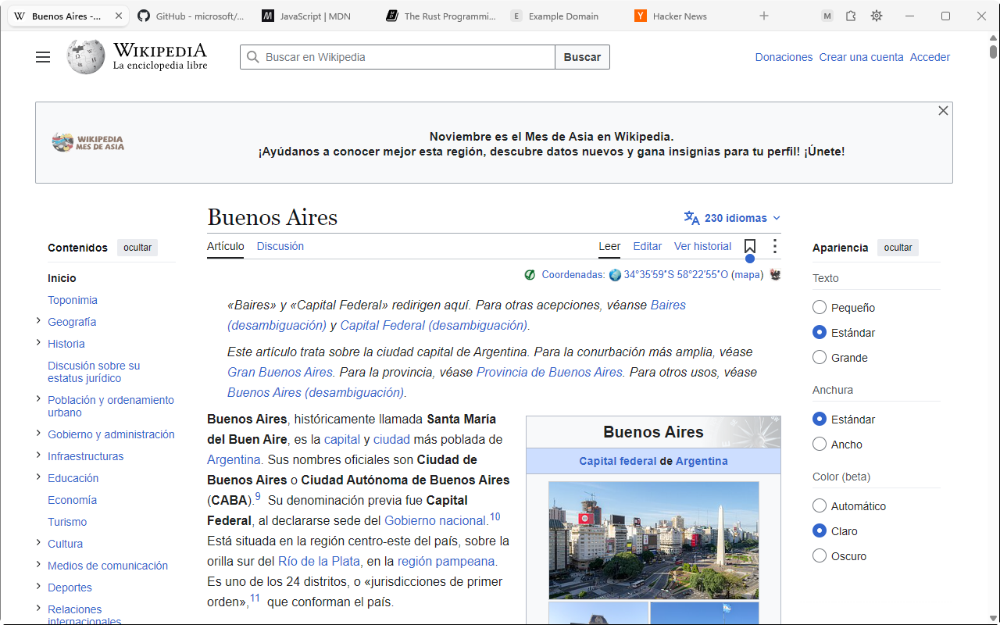

<p align="center">
  <picture>
    <source media="(prefers-color-scheme: dark)" srcset="assets/logo/nea-dark.svg">
    
  </picture>
</p>

<h1 align="center">Nea</h1>

<p align="center">Nea. Un navegador para Windows que gasta poca memoria: una fila de pestañas, un campo y la página.</p>

<p align="center">
  <a href="https://github.com/Agustin-Delgado/nea/actions/workflows/build.yml"></a>
  <a href="LICENSE"></a>
  
</p>

<picture>
  <source media="(prefers-color-scheme: dark)" srcset="docs/muestra/01-pestanas-arriba-oscuro.png">
  
</picture>

Sin barra de herramientas, sin página de inicio, sin cuentas y sin
telemetría. Todo pasa por un único campo que sirve para direcciones y
búsquedas. Está escrito en Rust, con interfaz Win32 nativa dibujada con
Direct2D, y usa el motor WebView2 que ya trae Windows.

## Por qué gasta poca memoria

El programa propio ocupa unos pocos MB. Las pestañas de fondo se duermen y,
pasado un rato, se descartan: queda sólo su dirección y su título. Al abrir,
sólo se crea la vista de la pestaña activa.

Memoria privada de todo el árbol de procesos, con las mismas páginas y un
perfil limpio en cada navegador:

| Escenario | Nea | Edge | Chrome |
|---|---:|---:|---:|
| Pestaña en blanco | 87 MB | 184 MB | 240 MB |
| Página liviana (example.com) | 110 MB | 201 MB | 247 MB |
| Página pesada, con bloqueo de anuncios | 395 MB | 641 MB | 784 MB |
| 20 pestañas (19 dormidas en Nea) | 183 MB | 451 MB | 491 MB |

Método, versiones y el resto de los escenarios en
[docs/medicion.md](docs/medicion.md).

## Funciones

- **Campo único** para direcciones y búsquedas, con autocompletado del
  historial local. Nada sale hasta presionar Enter.
- **Pestañas arriba o al costado**, ocultables, con fijadas, grupos de
  colores y cambio de pestaña por nombre.
- **Vista dividida**: dos páginas lado a lado.
- **Pestañas privadas** con su propio perfil InPrivate.
- **Modo lectura**, **video flotante** y **ocultar elementos** por sitio.
- **Contraseñas** en el Administrador de credenciales de Windows, con
  importación desde Chrome, Edge, Brave, Vivaldi, Opera, Arc o CSV.
- **Marcadores, historial y descargas** en paneles que se abren desde el campo.
- **Extensiones de Chrome** desde la Web Store, con
  [limitaciones conocidas](docs/extensiones.md).
- **Tema claro, oscuro o del sistema**, con animaciones que respetan la
  configuración de Windows.
- **Actualización diaria** firmada con Ed25519.

Estado de cada función y capturas: [docs/funciones.md](docs/funciones.md).
Recorrido con una foto por función y un video: [docs/muestra](docs/muestra/README.md).

## Instalación

Todavía no hay una versión publicada: por ahora se compila desde el código.

Requisitos:

- Windows 10 u 11 (x64);
- [Rust](https://rustup.rs) estable, con el destino `x86_64-pc-windows-msvc`;
- las herramientas de compilación de Visual Studio (MSVC) con el Windows SDK,
  que trae `rc.exe` para el ícono y el manifiesto;
- el [runtime de WebView2](https://developer.microsoft.com/microsoft-edge/webview2/),
  que ya viene con Windows 11 y con casi todos los Windows 10 actualizados.

```powershell
git clone https://github.com/Agustin-Delgado/nea.git
cd nea
cargo build --release
.\target\release\nea.exe
```

`nea.exe --install` lo instala para el usuario actual, sin permisos de
administrador. El instalador, el paquete portable y la firma están en
[docs/compilar.md](docs/compilar.md).

## Atajos

| Acción | Atajo |
|---|---|
| Campo único | Ctrl+L |
| Cambiar de pestaña por nombre | Ctrl+K |
| Nueva / cerrar / reabrir pestaña | Ctrl+T / Ctrl+W / Ctrl+Shift+T |
| Nueva pestaña privada | Ctrl+Shift+N |
| Pestañas arriba o al costado / ocultarlas | Ctrl+Shift+S / Ctrl+S |
| Buscar en la página | Ctrl+F |
| Modo lectura | Ctrl+Shift+R |
| Vista dividida | Ctrl+Alt+N |
| Marcadores / historial / descargas | Ctrl+Shift+O / Ctrl+Y / Ctrl+Shift+J |
| Ajustes | Ctrl+, |

Todos se cambian en Ajustes. Lista completa: [docs/atajos.md](docs/atajos.md).

## Privacidad

Sin cuentas, sin sincronización, sin telemetría y sin reporte de fallos. Lo
único que sale a la red son las páginas que se piden, sus íconos, las listas
de filtros y la comprobación diaria de actualización (que se puede apagar).

- **Anuncios y rastreadores:** bloqueados a nivel de red con EasyList y
  EasyPrivacy.
- **Rastreadores y cookies de terceros:** la prevención de rastreo del motor
  en nivel estricto.
- **Carteles de cookies:** ocultos antes de pintarse, con la EasyList Cookie
  List.
- **Ventanas emergentes:** bloqueadas las que nadie pidió y las de anuncios;
  los inicios de sesión con ventana siguen funcionando.

El bloqueo y las ventanas emergentes se permiten por sitio desde el menú de
la pestaña. Detalle y dónde se guarda cada dato:
[docs/privacidad.md](docs/privacidad.md).

## Documentación

- [Funciones](docs/funciones.md): qué hace, cómo se ve y qué está verificado.
- [Atajos](docs/atajos.md).
- [Privacidad y datos](docs/privacidad.md).
- [Compilar, instalar y publicar](docs/compilar.md): `build.ps1`, control por
  script, diagnóstico y actualizaciones.
- [Medición de memoria](docs/medicion.md).
- [Extensiones](docs/extensiones.md).
- [Diseño y movimiento](docs/diseno.md).
- [Muestra](docs/muestra/README.md): fotos y video.

## Estado

El código está completo, pero falta lo que sólo puede resolver una persona
antes de la primera versión:

- **Clave de firma de producción.** La pública de `keys/update-public.hex` es
  de desarrollo; hay que generar el par de producción y guardar la privada
  fuera del repositorio ([cómo](docs/compilar.md#firmar-una-versión)).
- **Certificado de firma de código.** Sin él, SmartScreen advierte al abrir
  el instalador y el programa.
- **Primera release y winget.** El actualizador ya apunta a los releases de
  este repositorio; el manifiesto de `packaging/winget/` necesita la dirección
  y el hash de esa release.

## Contribuir

Ver [CONTRIBUTING.md](CONTRIBUTING.md). Para reportar una vulnerabilidad,
[SECURITY.md](SECURITY.md): por favor, no abras un issue público.

## Licencia

[MIT](LICENSE). Las ideas vienen del navegador
[Search](https://github.com/driceroland/Search), de driceroland (MIT), que
sirvió de referencia funcional; Nea no contiene su código, su nombre ni
su ícono. Componentes de terceros en [NOTICE](NOTICE).
