# Features

## Appearance

Nea draws its interface with Direct2D and DirectWrite on Win32 windows. It
has no web interface and no Mica, because Mica tints the window with the
wallpaper color. Colors, type, corners, shadows and motion follow one design
system. The system uses neutral grays and an indigo for active items. No text
is heavier than medium. [design.md](design.md) has the table of all tokens.

These items move with measured curves and durations:

- The hover on tabs and buttons (150 ms).
- The card of the active tab, which slides to the selected tab.
- The neighbor tabs, which make space when a tab opens, closes or moves.
- The tab strip column, which comes back from the edge.
- The focus line of the split view.
- The field, the tab card, Settings and the password bar. They fade in and
  fade out.
- The toasts, with a spring curve.
- The checkboxes in Settings.

An interrupted animation continues from its current position. Animations do
not block input. At rest, Nea uses no timer and 0% CPU. If the Windows
animations are off, all items move to their final position immediately.

Nea has no title bar. The tab strip uses that space. The window buttons are
small versions of the Windows buttons: minimize, maximize and close. They are
at the start of the tab strip. Their glyphs are 8 px. They sit on a light
capsule with three 28 px segments. The Windows 11 buttons are 46 px.

The position of the window buttons depends on the tab strip:

- Tab strip on top: before the tabs.
- Tab strip on the side: at the top left of the column.
- Tabs hidden: at the left of the window row.

The segment under the pointer becomes darker. The close segment becomes red.
When the window is inactive, the glyphs become dim. When the pointer is on
maximize, Windows shows its snap layouts.

**Back, Forward and Reload** are next to the window buttons. With the tab
strip on the side, they are at the right of the same row, as in Arc. They
apply to the active tab. An arrow with no destination is dim and does not
respond. Right-click an arrow, or hold it down, to open the tab history in
that direction. The menu shows up to 15 entries, the nearest first. Mouse
buttons 4 and 5 go back and forward on the tab strip. On the page, the page
handles them.

The gear opens Settings and is always visible:

- Tab strip on top: at the end of the tab strip, at the right of the
  extensions.
- Tab strip on the side: at the bottom of the column.
- Tabs hidden: at the end of the window row.

When the pointer is on the gear, the tooltip "Settings (Ctrl+,)" appears.

**Zoom.** Ctrl+wheel, Ctrl+= and Ctrl+- zoom the page. Each tab has its
own zoom level. When the level of the active tab is not 100%, a small chip
shows the level, for example "125%". The chip is at the left of the
extensions button, on the row of the gear. It flashes at each change of the
level. Click the chip, or push Ctrl+0, to set the level back to 100%. At
100%, the chip is not shown. A tab that sleeps keeps its level for the next
view.

Each tab shows the icon of its site. A tab without an icon, or a private tab,
shows the initial of the site. When the pointer stops on a tab, a card
appears, as in Chrome. The card shows these items:

- The full title and the site.
- The state of the tab: asleep, suspended or always awake.
- A small preview of the page from the last time you saw it.

Nea keeps the previews only in memory, with a limit of 3 MB for all tabs. A
sleeping tab keeps its preview. When the pointer moves to a different tab,
the card moves immediately. A click, a drag or the field closes the card. To
turn off the preview, go to Settings → Tabs. The card stays.

| | |
|---|---|
| 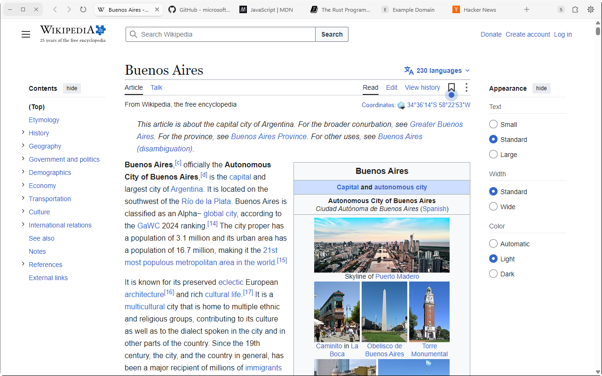 | 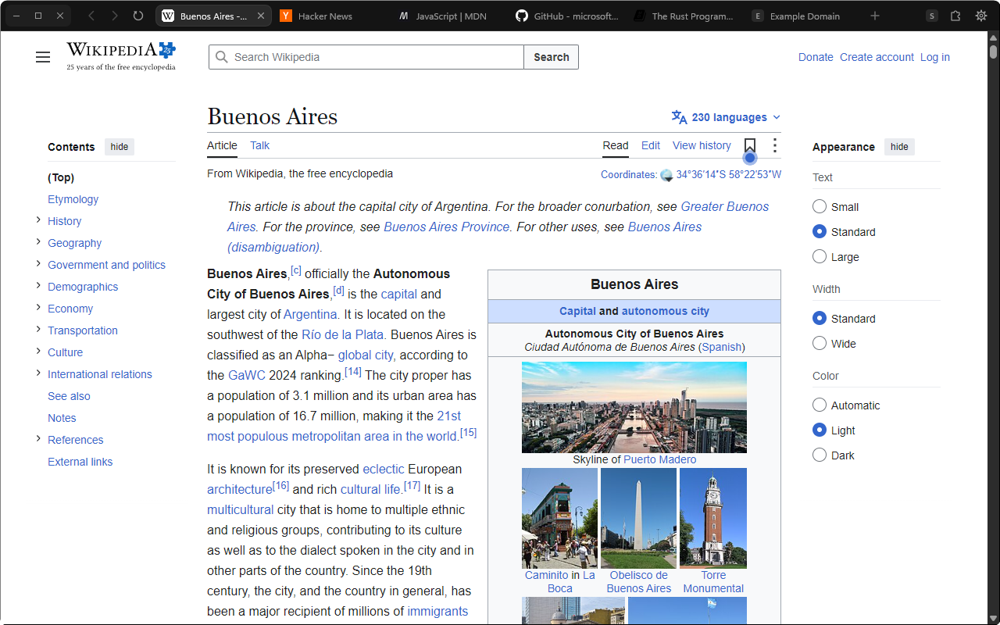 |
| 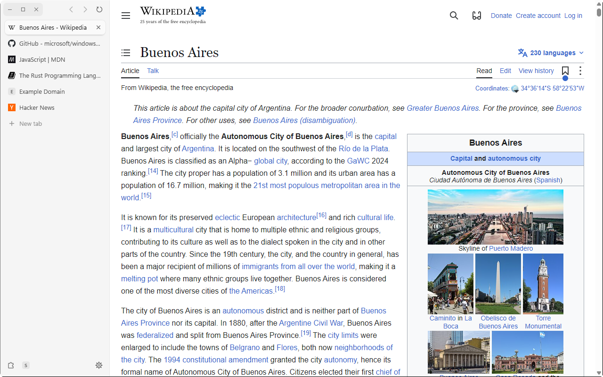 | 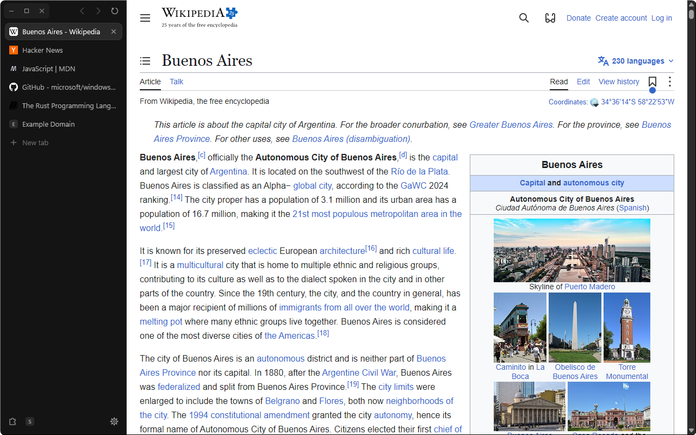 |
| 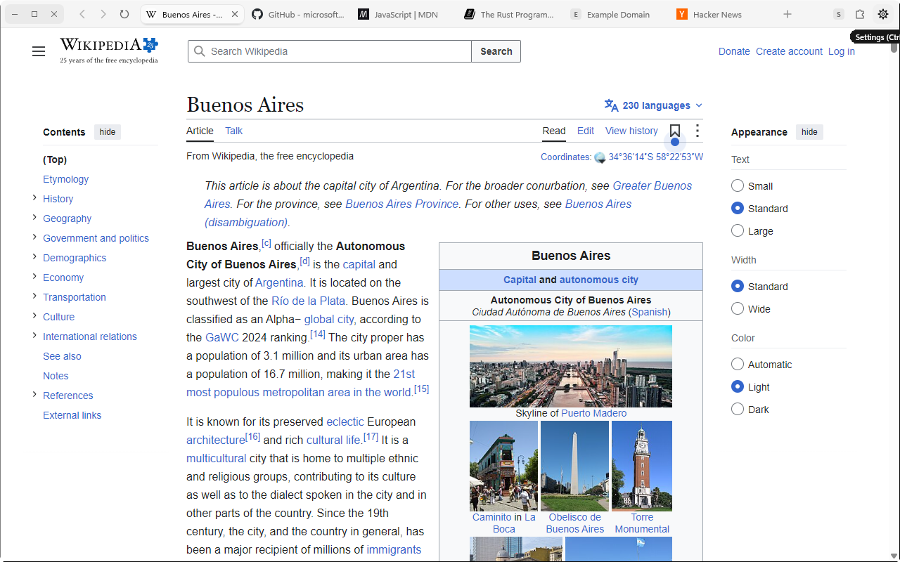 | 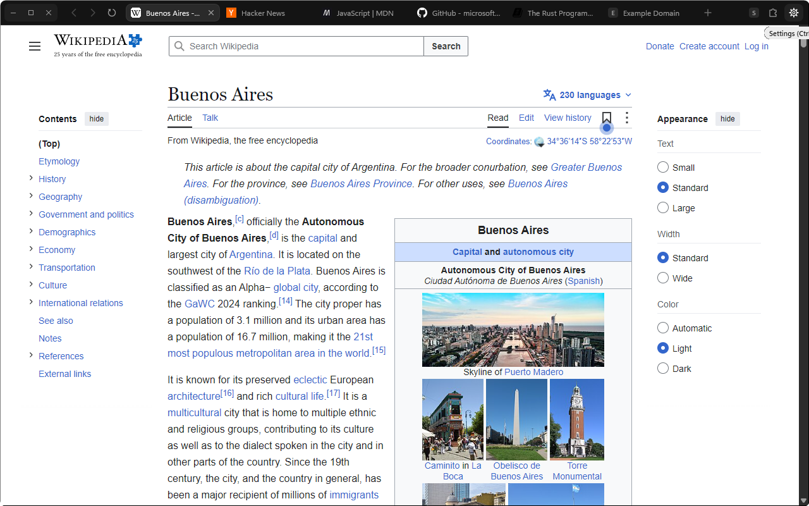 |
| 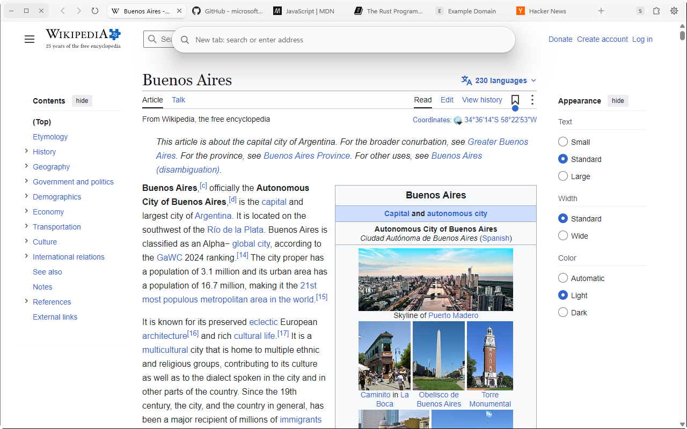 | 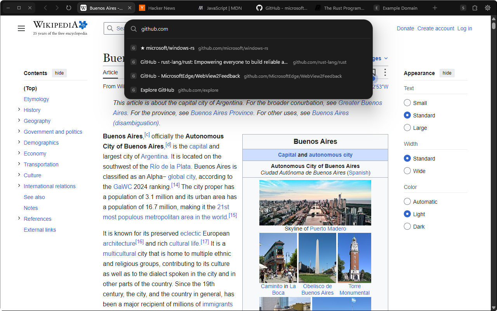 |
| 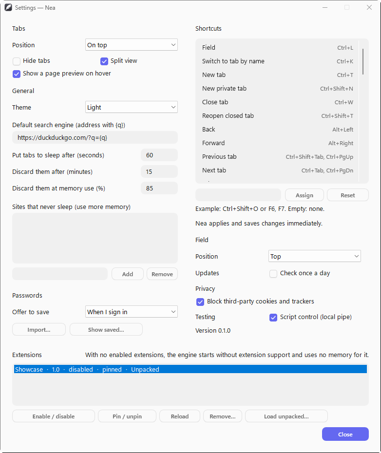 | 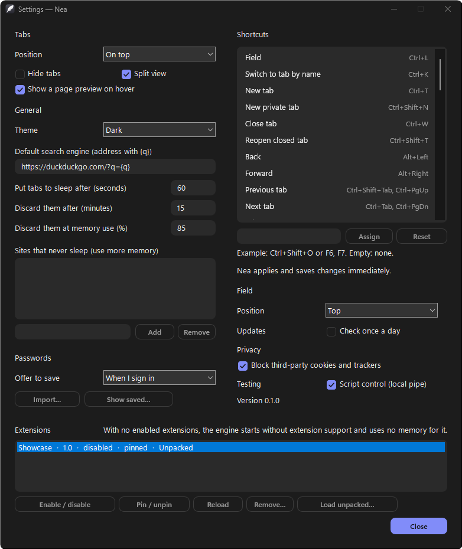 |
| 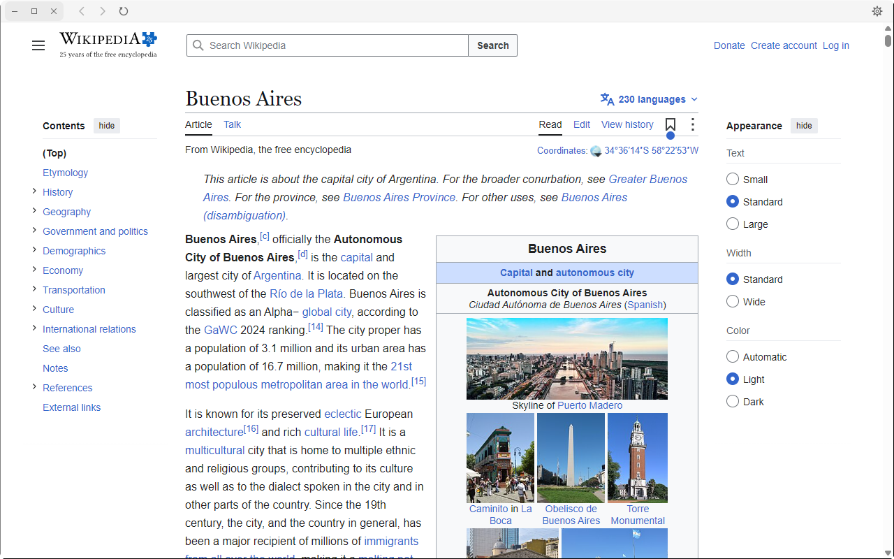 | 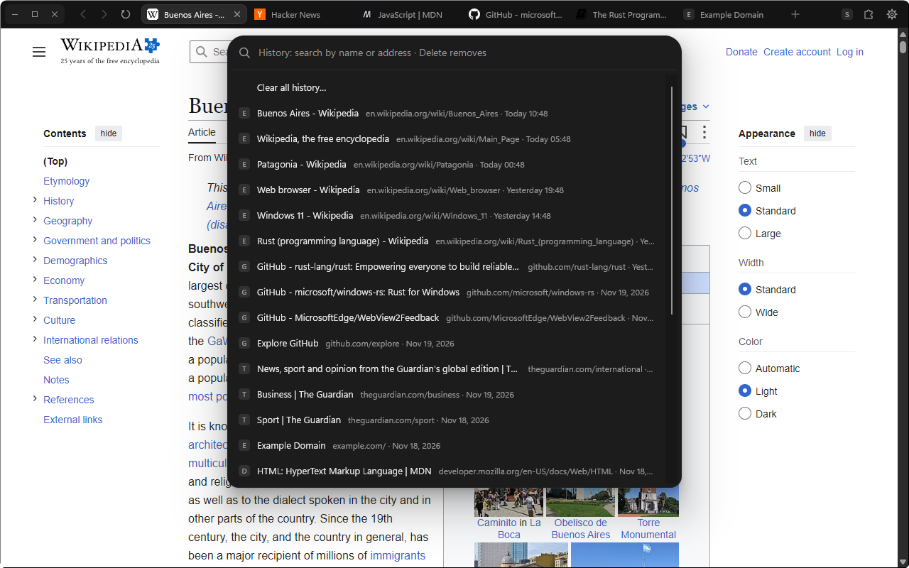 |
| 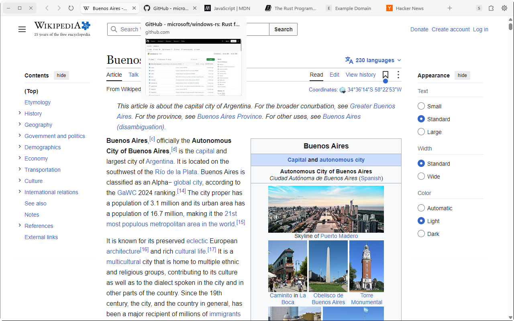 | 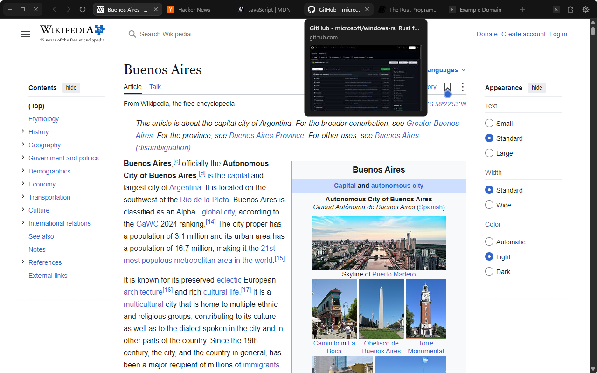 |
| 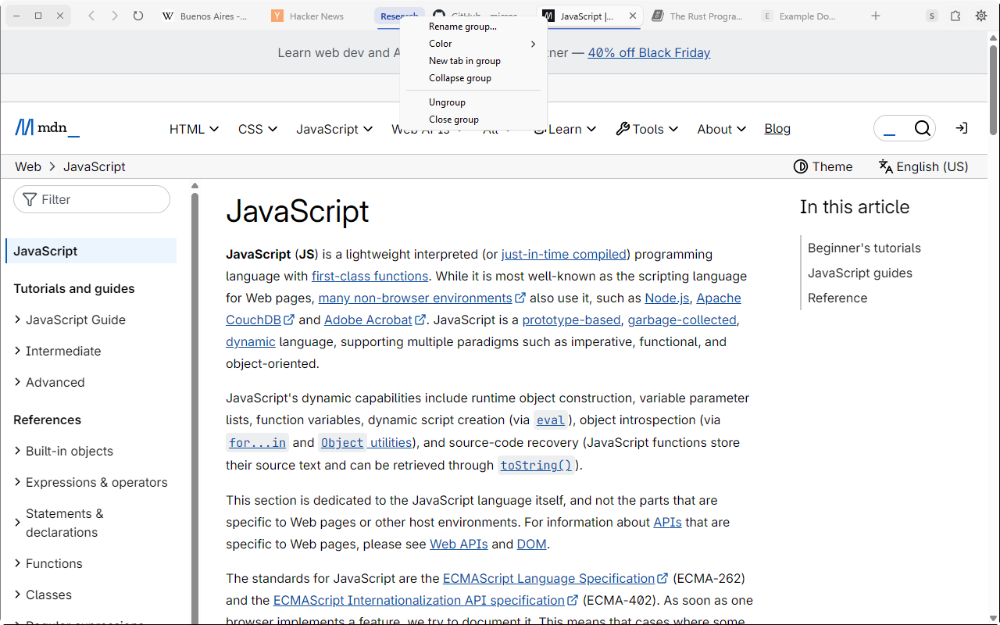 | 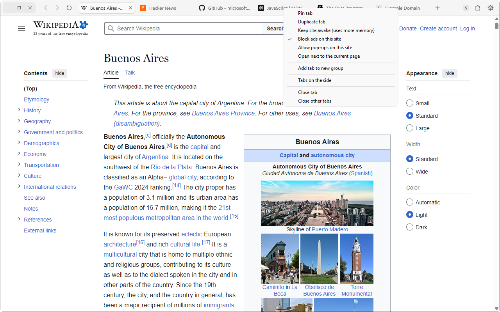 |

`tools/capture.ps1` and `tools/showcase.ps1` make the screenshots with
PrintWindow. They do not bring the window to the front. The screenshots do
not show the shadow and the border that Windows draws. `tools/frames.ps1`
records the intermediate frames of an animation, with the time of each frame.

The [showcase](showcase/README.md) has one screenshot for each feature and a
video.

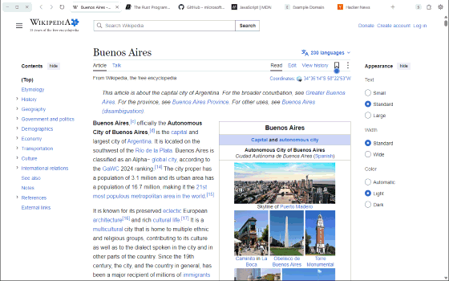

## Status of each feature

This table gives the status of each feature in this version. "Verified" means
that a test used the built program through the script control channel. The
table marks the items that this method cannot test.

| Feature | Status |
|---|---|
| One field for addresses and searches | Verified. Nea sends nothing until Enter. |
| Suggestions from the local history | Verified (suggestions and inline completion). |
| Tab strip on top or on the side, collapsible column | Verified. Select it in Settings → Tabs → Position, in the right-click menu of the tab strip or the window, or with Ctrl+Shift+S. |
| Pinned tabs | Verified. They stay across sessions. |
| Deferred restore | Verified. At startup, Nea creates only the view of the active tab and of its split pair. |
| Switch to tab by name | Verified (fuzzy search by title and address). |
| Sleep and discard of background tabs | Verified. Nea lowers their memory target after 20 s and suspends them (all but the last one at once, that one after the time in Settings). A suspended tab comes back as it was, with no load. Nea then empties the working set of the renderers that have only suspended pages. It discards a tab only when the system has almost no commit left, or after the time in Settings (off by default). Refer to [memory.md](memory.md). |
| Keep site awake | Verified. |
| Split view | Verified (pairs, persistence, private tabs). A person checks the drag of tabs and of the divider. |
| Spaces | Verified: swipe (to the next space, back, too short, past the first space, past the last space and back), switch with the shortcuts and Ctrl+K, move a tab, persistence, deferred restore and old session files. The swipe was sent as wheel messages: a person checks it on a real touchpad. A person checks the menus of a space and of a tab. |
| Tab groups | Verified: create, name, color, collapse, expand, persistence and split pairs in a group. Nea does not save private tabs. A test sent mouse messages to the Nea window to check the tab drag. A person checks the drag of the group label. |
| Reader mode | Verified (Readability). |
| Hide element for each site | Verified. You select the element with a click. Nea hides it before the page appears. A person checks the list of hidden elements (Ctrl+Shift+U), because it is a menu. |
| Floating video | Uses the Picture-in-Picture of the engine. Not verified in this pass, because it needs a page with video. |
| Ad and tracker blocking | Verified, with an exception for each site in the tab menu. It uses EasyList and EasyPrivacy. A small built-in list applies while they download. Read [privacy.md](privacy.md). |
| Pop-ups | Verified with local pages. Nea blocks pop-ups that nobody asked for and ad pop-ups. You can allow pop-ups for one site from the tab menu. A pop-up opens as a tab that keeps its `window.opener`, and it can close itself. |
| Sign in to Google one time | Verified without an account: the session cookies stay after a restart, a discard and an engine restart. "Sign in with Google" pop-ups, the Google button and One Tap work with strict tracking prevention. No Chrome Sync. Read [sign-in.md](sign-in.md). |
| Trackers and cookie banners | Verified. Nea uses the strict tracking prevention of the engine. It hides banners before the first frame (EasyList Cookie List). |
| Passwords in Credential Manager | Verified. Nea offers to save a password after a sign-in. It never fills in a password without your action. Ctrl+Alt+L opens the panel. |
| Password import from other browsers | Done for Chrome, Edge, Brave, Vivaldi, Opera, Arc and CSV, all on the local computer. Not verified in this pass, because the tests do not read real profiles. |
| Passkeys | The engine sends WebAuthn to the Windows Hello dialog (`tests/probes/webauthn_probe.rs`, in the private test repository). Not verified in this pass. |
| Light, dark or system theme | Light and dark verified. "System" follows the Windows theme when it changes. |
| Bookmarks, history and downloads | Verified. |
| Bookmarks bar | Verified: chips under a top strip, tiles in the column, the overflow, the setting and its shortcut, click, Ctrl+click, middle click, rename, remove and the drag that reorders. A test sent mouse messages to the Nea window. A person checks the menus. |
| Private tabs | Verified. They have their own InPrivate profile. Nea writes nothing to the history, the session, Ctrl+Shift+T or settings.json. |
| Chrome extensions | Verified: install with the "Add to Chrome" button of the Chrome Web Store (Nea asks first), load, remove, the button and pinned extensions. The limitations are in [docs/extensions.md](extensions.md). |
| Find in page | Verified. |
| Signed updates | Verified. Nea checks soon after it starts and then every 4 hours. When a verified update is ready, the **Update** chip next to the gear (and **Restart to update** in the menu of the tab strip) restarts Nea into the new version and opens the tabs again. A development build never downloads or installs an update. The updater uses the releases of this repository. |
| Script control | Verified. Read [building.md](building.md#script-control). |
| Settings | Verified: general, tabs, passwords, extensions, shortcuts, updates, privacy and testing. Nea saves each change immediately. |

[docs/benchmarks.md](benchmarks.md) compares the memory of Nea with Edge. [docs/memory.md](memory.md) tells how Nea keeps its memory low.

## Spaces

A space is a set of tabs with a name and a color, for example "Work" and
"Personal". The window shows the tabs of one space at a time. Go to a
different space to see its tabs. The tabs of the other spaces stay open in
the background. A new window has one space, "Personal".

- **Swipe:** put two fingers on the touchpad over the tabs (the top strip
  or the column) and move them to the side. The tabs move with your
  fingers, and the tabs of the next space (or of the previous space) come in
  beside them. Lift your fingers: if the tabs moved more than a third of the
  way, or if you swiped quickly, the other space comes in. If not, the tabs
  go back. One swipe moves one space. Before the first space, the tabs
  stretch a little and go back. With a mouse, hold Shift and turn the
  wheel over the tabs: each turn moves one space.
- **New space:** swipe past the last space (it must have one tab or more).
  A new, empty space comes in, and the field opens for its first tab. If you
  swipe back before you open a tab in it, Nea removes the new space. You can
  also right-click an empty area of the tab strip and select "New space":
  the field then opens to name it. New spaces are "Space 2", "Space 3"…
  until you rename them. Nea keeps at most nine spaces.
- **Shortcuts:** Ctrl+Shift+1 … Ctrl+Shift+9 go to space 1 to 9.
  Ctrl+Shift+PgDn and Ctrl+Shift+PgUp go to the next and the previous space.
  The tabs slide in from the side of the space, as with a swipe.
- **Ctrl+K** finds the tabs of all spaces. A tab of a different space shows
  the name of its space. Select it to go to its space and its tab.
- **Which space:** with two spaces or more, the ground of the tab strip has
  a light tint of the color of the active space. A top strip has a 2 px
  line in that color at its bottom. The column shows the color dot and the
  name of the active space at its bottom, next to the gear. During a switch
  and for one second after it, the name of the space shows on a small card
  in the middle of the tabs.
- **Rename, color, delete:** click or right-click the name at the bottom of
  the column. On a top strip, right-click an empty area of the strip and
  select "This space". The commands are "Rename space…", the color, "New
  space" and "Delete space (keep its tabs)". A deleted space never closes a
  tab: its tabs go to the space before it (the first space gives its tabs
  to the next one).
- **Move a tab:** right-click a tab and select "Move to space", then a space
  or "New space". The tab leaves its group. The two tabs of a split view
  pair move together.

Each space remembers its active tab. When you come back to a space, that
tab is active again. An empty space opens the field for a new tab. When you
close the last tab of a space, the window stays open.

A switch is as fast as a tab switch. Nea moves the tabs from one list to the
other, shows one page and hides one. It creates no page and closes no page.
During a swipe, Nea draws only the tab strip: the page changes one time,
when you lift your fingers and the other space comes in. If the Windows
animations are off, the tabs do not follow the fingers, and the change is
immediate.
The tabs of the other spaces are background tabs: they go to sleep and are
discarded as all other background tabs.

The session keeps the spaces, their names, their colors and their active
tabs. At startup, Nea creates only the view of the active tab of the active
space (and of its split pair). A session file of an older version opens in
one space. A private tab stays in the space where you opened it, and Nea
never saves it.

## Tab groups

Tab groups work as in Chrome and Edge. Right-click a tab to see these
commands:

- "Add tab to new group" (Ctrl+Shift+G).
- "Add to group", with the existing groups.
- "Remove tab from group".

A new group asks for its name in the field. Press Enter with an empty field
to keep the group without a name.

- **Tab strip on top:** each group has a label before its tabs. The label
  shows the name in the group color on a light tint of that color. A group
  without a name shows only a dot. A thin line of the same color joins the
  tabs.
- **Tab strip on the side:** each group is a row with a dot, the name in its
  color and an arrow. A group without a name shows the site of its first tab.
  Its tabs are below the row, with a small indent and a thin guide at the
  left.
- **Click the label** to collapse the group in 220 ms. The tabs fold and fade
  out, and the arrow turns. Only the label stays. On the side, the label shows
  the number of tabs. If the active tab was in the group, a visible tab
  becomes active. Ctrl+Tab skips collapsed tabs. If you select a collapsed tab
  with Ctrl+K or Ctrl+1…8, its group expands.
- **Right-click the label** to see these commands: "Rename group", the color,
  "New tab in group", "Collapse group" or "Expand group", "Ungroup" and "Close group".
  There are nine colors, from the brand hues. They are easy to read in light
  and dark.
- **Drag a tab** onto a different tab to put it in the group of that tab.
  Drop it onto a label to put it before that group, outside it. Drop it after
  the last tab to put it at the end, without a group. Drag the label to move
  the full group. The tabs of a group always stay together.
- Pinned tabs cannot be in groups. Private tabs can be in groups, but Nea
  does not save them. In the next session, the group comes back without them.
  The two tabs of a split view pair always stay in the same group.

The commands "Remove tab from group" and "Collapse or expand group" have no
default shortcut. You can assign a shortcut in Settings.

## Bookmarks bar

The bookmarks bar shows your bookmarks above the tabs, as Safari and Arc do.
It shows only when you have one or more bookmarks. Ctrl+Shift+B bookmarks
the current page.

- **Tab strip on top:** a slim bar (28 px) under the strip. Each bookmark is
  a chip with the icon of the site and the title. A long title stops at
  160 px. The bookmarks that do not fit go into the **»** menu at the right
  end. The page moves down by the height of the bar.
- **Tab strip on the side:** square tiles at the top of the column, above
  the tabs, as the favorites of Arc. Each tile shows the icon of the site,
  or its initial. The tiles fill the width of the column, with up to three
  rows. The bookmarks that do not fit go into the **…** tile.
- When the pointer stops on a bookmark, a tooltip shows the title and the
  site.
- **Click** a bookmark to open it in the current tab. **Ctrl+click** or
  **middle-click** it to open it in a new tab behind the current tab. The
  new tab sleeps until you select it.
- **Right-click** a bookmark to see these commands: "Open in new tab", "Open
  in new private tab", "Rename…", "Remove" and "Hide bookmarks bar".
  "Rename…" asks for the name in the field.
- **Drag** a bookmark along the bar to change its place. The bookmarks panel
  (Ctrl+Shift+O) uses the same order. A new bookmark goes first.
- To hide or show the bar, use Settings → Tabs → "Show bookmarks bar", or
  Alt+Shift+B.

Nea keeps the bar in memory. A paint reads no file, and Nea measures the
titles one time for each change. A change in the bookmarks panel, Ctrl+Shift+B
and the commands of the bar update it immediately.

## Manual checks

A person checks these items manually:

- The drag of tabs and of the split view divider.
- The menus with a real mouse and a real keyboard: tab, group, space, extensions, hidden elements, the bookmarks bar, the history of Back and Forward and the password import. A script checked how they open, their items, the keys, the submenus and how they close (`tools\menus.ps1`). A person checks the click outside a menu, the release of the right button on an item, a second monitor and a screen reader.
- The accounts of a sign-in.
- The floating video.
- The password import.
- The passkeys.
