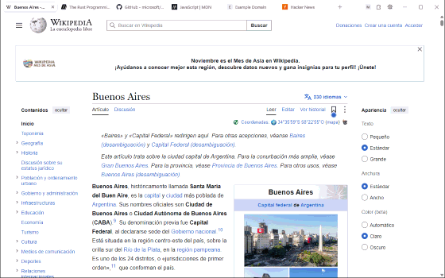

# Muestra

Todo lo que hace Nea, en fotos y en video. Las fotos son la ventana
entera (1280×800), capturada con PrintWindow sin traerla al frente; la
sombra y el borde que dibuja Windows no salen. Los datos (historial,
marcadores, descargas) son sintéticos y el panel de contraseñas está vacío
a propósito.

Video completo: [nea.mp4](nea.mp4) (H.264, 30 cuadros/s). Las
escenas y el segundo en que empieza cada una están en
[escenas-video.txt](escenas-video.txt).

## Fotos

| Foto | Qué muestra |
|---|---|
| [01 claro](01-pestanas-arriba-claro.png) · [oscuro](01-pestanas-arriba-oscuro.png) | Pestañas arriba, con el ícono de cada sitio |
| [02 claro](02-pestanas-al-costado-claro.png) · [oscuro](02-pestanas-al-costado-oscuro.png) | Pestañas al costado, en columna |
| [03 claro](03-pestanas-colapsadas-claro.png) · [oscuro](03-pestanas-colapsadas-oscuro.png) | Columna oculta: sólo la fila de la ventana |
| [04 claro](04-engranaje-y-botones-de-ventana-claro.png) · [oscuro](04-engranaje-y-botones-de-ventana-oscuro.png) | Engranaje de Ajustes con su tooltip y los botones de la ventana |
| [05 claro](05-boton-cerrar-claro.png) · [oscuro](05-boton-cerrar-oscuro.png) | El botón de cerrar bajo el puntero |
| [06 claro](06-tarjeta-de-pestana-claro.png) · [oscuro](06-tarjeta-de-pestana-oscuro.png) | Tarjeta al dejar el puntero sobre una pestaña, con la miniatura de la página |
| [07](07-iconos-de-sitios-claro.png) | La fila de pestañas ampliada: íconos de sitios (y la inicial cuando el sitio no tiene) |
| [08 claro](08-campo-vacio-claro.png) · [oscuro](08-campo-vacio-oscuro.png) | Campo único vacío (nueva pestaña) |
| [09 claro](09-campo-autocompletado-claro.png) · [oscuro](09-campo-autocompletado-oscuro.png) | Escribiendo «git»: se completa con el historial y los marcadores (★) |
| [10 claro](10-cambiar-de-pestana-claro.png) · [oscuro](10-cambiar-de-pestana-oscuro.png) | Cambiar de pestaña por nombre |
| [11 claro](11-buscar-en-la-pagina-claro.png) · [oscuro](11-buscar-en-la-pagina-oscuro.png) | Buscar en la página |
| [12 claro](12-panel-marcadores-claro.png) · [oscuro](12-panel-marcadores-oscuro.png) | Panel de marcadores |
| [13 claro](13-panel-historial-claro.png) · [oscuro](13-panel-historial-oscuro.png) | Panel de historial |
| [14 claro](14-panel-descargas-claro.png) · [oscuro](14-panel-descargas-oscuro.png) | Panel de descargas |
| [15 claro](15-panel-contrasenas-claro.png) · [oscuro](15-panel-contrasenas-oscuro.png) | Panel de contraseñas, vacío |
| [16 claro](16-ajustes-claro.png) · [oscuro](16-ajustes-oscuro.png) | Ajustes, completa |
| [17 claro](17-vista-dividida-claro.png) · [oscuro](17-vista-dividida-oscuro.png) | Vista dividida: dos páginas, el divisor y la línea de foco sobre la activa |
| [18 claro](18-campo-pestana-privada-claro.png) · [oscuro](18-campo-pestana-privada-oscuro.png) | El campo de una pestaña privada nueva |
| [19 claro](19-pestana-privada-claro.png) · [oscuro](19-pestana-privada-oscuro.png) | Pestaña privada con su marca violeta |
| [20 claro](20-modo-lectura-claro.png) · [oscuro](20-modo-lectura-oscuro.png) | Modo lectura |
| [21](21-ocultar-elemento-claro.png) | Ocultar elemento: el selector activo marca el recuadro bajo el puntero |
| [22](22-elemento-oculto-claro.png) | La misma página con el recuadro ya oculto |
| [23](23-emergente-bloqueada-claro.png) | Aviso de ventana emergente bloqueada |
| [24](24-menu-de-pestana-claro.png) | Menú contextual de una pestaña |
| [25](25-boton-de-extensiones-claro.png) | Botón de extensiones y su menú (con una extensión local de prueba, deshabilitada) |
| [26](26-bloqueo-de-anuncios-infobae.png) | infobae.com como viene Nea y con el bloqueo de anuncios y de rastreadores apagado |
| [27](27-pestana-dormida-claro.png) | Tarjeta de una pestaña dormida: «se vuelve a cargar al abrirla» |

## Cómo se hizo

- `tools/muestra.ps1`: arranca un Nea propio (`NEA_BENCH=1`, datos
  en una carpeta temporal) y lo maneja por el pipe de control y con
  mensajes a sus propias ventanas. Nada de entrada global.
- `tools/muestra-fotos.ps1`: las fotos.
- `tools/muestra-video.ps1`: graba los cuadros (unos 22 por segundo; la
  grabación se frena mientras carga una página) y arma el MP4 y el GIF con
  `cargo run --release --example encode_mp4` (Media Foundation y WIC, que
  vienen con Windows).
