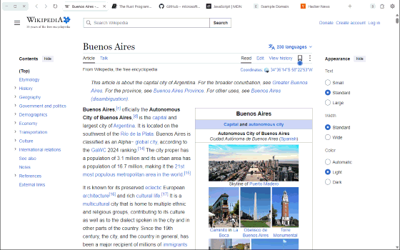

# Showcase

This page shows all Nea features in screenshots and in a video. Each
screenshot shows the full window (1280×800). PrintWindow captured it without
a move to the front. The screenshots do not show the shadow and the border
that Windows draws. The history, bookmarks and downloads are synthetic data.
The passwords panel is empty on purpose.

Full video: [nea.mp4](nea.mp4) (H.264, 30 frames/s).
[video-scenes.txt](video-scenes.txt) gives the scenes and the start time of
each scene.

## Screenshots

| Screenshot | Contents |
|---|---|
| [01 light](01-tabs-top-light.png) · [dark](01-tabs-top-dark.png) | Tab strip on top, with the icon of each site |
| [02 light](02-tabs-side-light.png) · [dark](02-tabs-side-dark.png) | Tab strip on the side, in a column |
| [03 light](03-tabs-collapsed-light.png) · [dark](03-tabs-collapsed-dark.png) | Column hidden: only the window row |
| [04 light](04-settings-button-and-window-buttons-light.png) · [dark](04-settings-button-and-window-buttons-dark.png) | The Settings gear with its tooltip, and the window buttons |
| [05 light](05-close-button-light.png) · [dark](05-close-button-dark.png) | The close button under the pointer |
| [06 light](06-tab-card-light.png) · [dark](06-tab-card-dark.png) | The tab card when the pointer stops on a tab, with a preview of the page |
| [07](07-site-icons-light.png) | The tab strip, enlarged: site icons, and the initial of a site without an icon |
| [08 light](08-field-empty-light.png) · [dark](08-field-empty-dark.png) | The empty field (new tab) |
| [09 light](09-field-autocomplete-light.png) · [dark](09-field-autocomplete-dark.png) | The text "git" in the field, with suggestions from the history and the bookmarks (★) |
| [10 light](10-switch-tab-light.png) · [dark](10-switch-tab-dark.png) | Switch to tab by name |
| [11 light](11-find-in-page-light.png) · [dark](11-find-in-page-dark.png) | Find in page |
| [12 light](12-bookmarks-panel-light.png) · [dark](12-bookmarks-panel-dark.png) | Bookmarks panel |
| [13 light](13-history-panel-light.png) · [dark](13-history-panel-dark.png) | History panel |
| [14 light](14-downloads-panel-light.png) · [dark](14-downloads-panel-dark.png) | Downloads panel |
| [15 light](15-passwords-panel-light.png) · [dark](15-passwords-panel-dark.png) | Passwords panel, empty |
| [16 light](16-settings-light.png) · [dark](16-settings-dark.png) | Settings, all sections |
| [17 light](17-split-view-light.png) · [dark](17-split-view-dark.png) | Split view: two pages, the divider and the focus line on the active page |
| [18 light](18-private-tab-field-light.png) · [dark](18-private-tab-field-dark.png) | The field of a new private tab |
| [19 light](19-private-tab-light.png) · [dark](19-private-tab-dark.png) | A private tab with its purple mark |
| [20 light](20-reader-mode-light.png) · [dark](20-reader-mode-dark.png) | Reader mode |
| [21](21-hide-element-light.png) | Hide element: the picker outlines the element under the pointer |
| [22](22-element-hidden-light.png) | The same page after Nea hides the element |
| [23](23-popup-blocked-light.png) | The "Pop-up blocked" notice |
| [24](24-tab-menu-light.png) | The context menu of a tab |
| [25](25-extensions-button-light.png) | The extensions button and its menu, with a disabled local test extension |
| [26](26-ad-blocking-infobae.png) | infobae.com with the default Nea settings, and with ad and tracker blocking off |
| [27](27-sleeping-tab-light.png) | The card of a sleeping tab: "Asleep: reloads when you open it" |
| [28](28-tab-groups-light.png) | A tab group on the tab strip, with the label menu open |

## Method

- `tools/showcase.ps1` starts a separate Nea instance (`NEA_BENCH=1`, data in
  a temporary folder). It controls Nea through the control pipe and with
  messages to the Nea windows. It sends no global input.
- `tools/showcase-shots.ps1` makes the screenshots.
- `tools/showcase-video.ps1` records the frames, about 22 each second. The
  recording stops while a page loads. Then the script makes the MP4 and the
  GIF with `cargo run --release --example encode_mp4`. This uses Media
  Foundation and WIC, which Windows includes.
